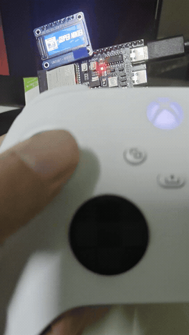

# Introduction

Based on Retro-Go, it integrates the functionality of connecting to the Xbox wireless controller via BLE. It uses an ESP32 S3 N16R8 development board, utilizes a portion of Flash memory as a file partition for game storage, and employs a 0.96-inch screen.

This branch is a NES-only build: the full Retro-Go system (launcher UI, settings, GUI, display, audio, Xbox BLE input and internal FAT storage) is kept, but the only emulator compiled into the firmware is nofrendo. See `NES_ONLY_BUILD.md` / `cmdlist.txt` for the build procedure.

# Preview

# Toolchain

ESP-IDF v5.1.6 PowerShell

# Usage

1. Build the image (see `cmdlist.txt`) or download img, bin([Releases](https://github.com/lakiax/retro-go-esp32s3-xbox/releases/))

2. Flash firmware
   
   `python -m esptool write_flash 0x0 .\retro-go_44f6d-dirty_esp32s3-xbox-096inch.img`

3. Flash game firmware to internal storage
   
   `python -m esptool write_flash <VFS_OFFSET> roms.bin`
   
   `<VFS_OFFSET>` must be read from the partition table of the image you just built:
   
   `python -m esptool read_flash 0x8000 0xC00 partitions.bin`
 0x8000:ESP32 系列分区表的默认存放偏移，ESP-IDF 官方文档明确写「在 flash 的默认偏移地址 0x8000 处烧写一张分区表」
 0xC00:读取长度 = 3072 字节（3 KiB）。这正是官方规定的分区表长度，最多容纳 95 条分区条目；每条 32 字节，末尾还有一条 MD5 校验条目，启用安全启动时后面还会跟签名，因此整个表实际占一个 0x1000（4 KiB）扇区 

   `python $env:IDF_PATH/components/partition_table/gen_esp32part.py partitions.bin`
   
   The old hard-coded `0x6A0000` / `0x840000` offsets no longer apply: with fewer app partitions the vfs partition moves. Writing roms.bin to a stale offset corrupts an app partition.

# Reference

- [retro-go](https://github.com/ducalex/retro-go)

- [esp32s3_xbox_adapter](https://github.com/jocover/esp32s3_xbox_adapter)

# License

Everything in this project is licensed under the [GPLv2 license](COPYING). Third-party emulator code kept in this NES-only build is nofrendo (see `retro-core/components/nofrendo/COPYING`). The upstream fMSX and Lynx/handy exceptions no longer apply because those apps and components are removed.
